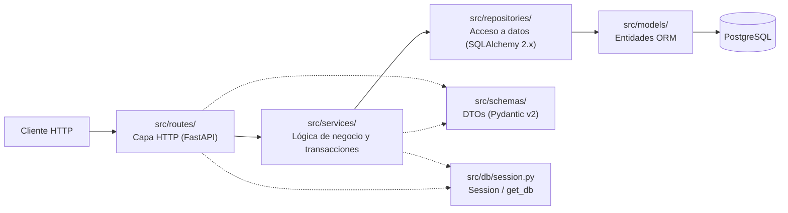

# Arquitectura del Sistema

Este documento define la arquitectura objetivo y los límites de responsabilidad para `fastapi-ecommerce`.

## Arquitectura por capas

El proyecto sigue una **arquitectura en capas** orientada a recursos con flujo de dependencias estrictamente unidireccional:

### Regla de dirección de dependencias

- `routes` puede importar de `services`, `schemas`, `db.session` (`get_db`). **No** debe importar `repositories` ni `models` directamente.
- `services` puede importar de `repositories`, `models`, `schemas`. **No** debe importar de `routes`.
- `repositories` puede importar de `models` y `sqlalchemy`. **No** debe importar de `routes`, `services` ni `fastapi`.
- `models` solo importa de `src.db.session` (`Base`) y `sqlalchemy`. **No** conoce schemas, servicios ni FastAPI.
- `schemas` solo importa de `pydantic` y librería estándar (`decimal`, `typing`, `datetime`). **No** importa modelos SQLAlchemy ni sesiones.

---

## Responsabilidad de cada capa

### 1. `src/routes/` — Capa de presentación / HTTP
- Define routers de FastAPI (`APIRouter`) agrupados por recurso (`products.py`, `categories.py`, `orders.py`).
- Recibe parámetros de path, query y body validados por Pydantic.
- Inyecta la sesión de base de datos con `db: Session = Depends(get_db)`.
- Delega toda la operación al servicio correspondiente y retorna el resultado serializado mediante `response_model` o tipo de retorno.
- **Prohibido:** escribir queries SQLAlchemy, invocar `db.commit()` / `db.rollback()`, o implementar reglas de negocio (como validar stock o unicidad).
- Todos los routers se registran únicamente en `src/routes/__init__.py`.

### 2. `src/services/` — Capa de lógica de negocio
- Concentra las reglas de dominio y casos de uso:
  - Validar existencia de entidades (ej. producto, categoría) y lanzar `HTTPException(404)` cuando no existan.
  - Validar unicidad (ej. nombre de categoría duplicado → `HTTPException(409)`).
  - Validar relaciones entre entidades (ej. `category_id` existente al crear o actualizar un producto).
  - Orquestar flujos complejos como **órdenes de compra**: verificar que cada producto exista y esté activo (`is_active=True`), validar `quantity > 0` y `quantity <= stock`, calcular `total` con `Decimal`, descontar stock y persistir la orden.
- **Dueña del límite transaccional:** decide cuándo ejecutar `db.commit()` y `db.rollback()`.

### 3. `src/repositories/` — Capa de acceso a datos
- Encapsula consultas y operaciones CRUD con SQLAlchemy 2.x (`select`, `db.get`, `db.scalars`, `db.scalar`, `db.add`, `db.delete`).
- No contiene reglas de negocio ni lanza `HTTPException`.
- Retorna instancias ORM, `list[Model]` o `None` (nunca `ScalarResult` sin materializar).
- En operaciones de escritura que participen en transacciones compuestas (ej. órdenes + stock), usa `db.flush()` en lugar de `db.commit()` para que el servicio controle la atomicidad completa.

### 4. `src/models/` — Entidades ORM
- Define tablas, columnas, llaves foráneas, índices, relaciones y restricciones a nivel de base de datos (`CheckConstraint`, `unique=True`, `nullable=False`).
- Todos los modelos heredan de `Base` (`src/db/session.py`).
- Todo modelo nuevo **debe importarse y exportarse** en `src/models/__init__.py` (`__all__`) para que `Base.metadata` lo registre correctamente en `init_db.py`.

### 5. `src/schemas/` — Contratos de entrada y salida (DTOs)
- Define los contratos públicos de la API con Pydantic v2, desacoplando la representación HTTP del modelo ORM.
- Valida tipos, rangos y formatos de entrada (`min_length`, `max_length`, `gt=0`, `ge=0`, `max_digits`, `decimal_places`).

### 6. `src/core/` y `src/db/` — Infraestructura
- `src/core/config.py`: centraliza la configuración con `pydantic-settings` (`Settings`). Ningún módulo debe leer variables de entorno directamente con `os.getenv`.
- `src/db/session.py`: configura `engine`, `SessionLocal`, `Base` y el generador `get_db()` (una sesión por petición HTTP, cerrada siempre en `finally`).
- `src/db/init_db.py`: inicialización de esquema para desarrollo. Para entornos productivos o cambios evolutivos de esquema, planificar la adopción de **Alembic**.

---

## Transacciones y concurrencia

- Cada petición HTTP obtiene su propia `Session` mediante `Depends(get_db)`.
- **Operaciones atómicas obligatorias:** cualquier operación que modifique múltiples tablas o registros dependientes (por ejemplo, crear una orden y descontar `Product.stock`) debe ejecutarse en una **única transacción**:
  1. Si alguna validación falla antes de persistir, no se modifica ningún registro.
  2. Si ocurre un error durante la persistencia, ejecutar `db.rollback()` antes de propagar el error.
  3. Para evitar condiciones de carrera al descontar stock en compras concurrentes, bloquear las filas afectadas con `select(Product).where(...).with_for_update()` dentro de la transacción.
- Mantener la restricción de integridad en base de datos (`CheckConstraint('stock >= 0')`) como última línea de defensa.

---

## Política sobre código legacy y migración

- `src/db/mock.json` está **deprecado** y no debe usarse en nuevas funcionalidades.
- Al tocar módulos legacy (como `src/routes/products.py`), migrarlos a la arquitectura `routes -> services -> repositories -> models`.
- `src/app.py` debe limitarse a instanciar `FastAPI`, configurar middlewares/lifespan si se requieren, e incluir el router raíz (`src.routes.router`). No ejecutar lógica de base de datos al importar el módulo.
